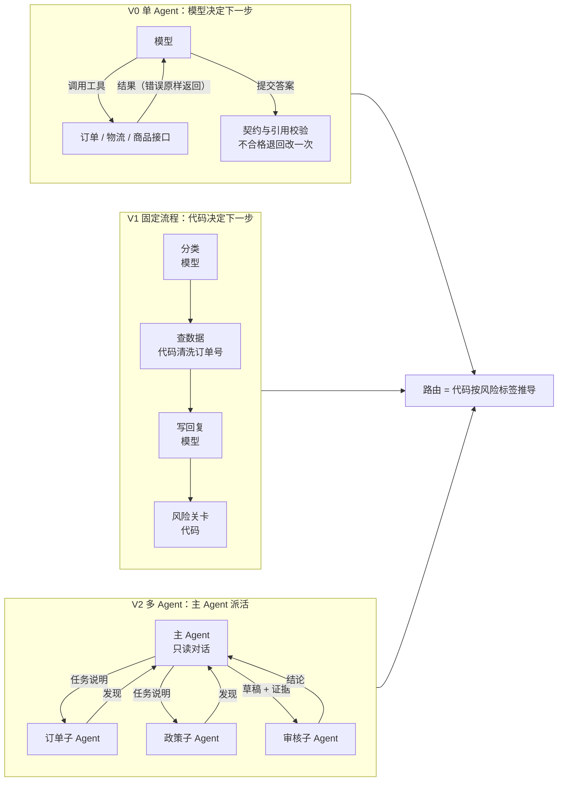

# 跨境电商客服 Agent：让 AI 回复"每句话都有出处"

一个处理跨境女装店客户询盘与售后的 AI Agent。它读完客户的多轮邮件，自己去查订单、物流、商品和政策，写出回复草稿，并按风险决定这封回复是直接发出、交人工审核，还是转人工处理。

项目的重点不在"能回复"，而在三件事：**回复里的每个事实都能追溯到来源**；**高风险决策不交给模型**；**在没有标准答案的情况下，也能量化质量、用数据驱动迭代**。

> 个人项目 · Python · Anthropic SDK（工具调用、提示缓存）· LangGraph · JSON Schema · pytest
> 品牌、订单和消息均为虚构的模拟数据。

---

## 一分钟看懂

| | |
|---|---|
| **解决的问题** | 跨境店铺客服每天要回大量"包裹到哪了、能不能退、降价能补差吗"这类消息。回复里几乎每句话都是一个事实（日期、金额、状态、政策），AI 说错一句就可能造成真实的退款损失或平台纠纷。 |
| **做了什么** | 一个能自己查数据、写回复、判断风险的 Agent，加上一整套评测和迭代工具：输出契约、引用校验、无标签质量指标、预算控制、运行记录和回放。 |
| **实测结果** | 在 180 条英 / 德 / 西 / 法多语言询盘上：**每条成本 $0.0008**（不到 0.1 美分），**缓存命中 95%**，**输出 100% 符合契约**，中位延迟 12 秒。 |
| **迭代成果** | 按"失败归类 → 定位原因 → 修复 → 全量重跑"做了 2 轮迭代，两类目标错误都从 2–3 条降到 0，修复后的两次运行方向一致；同时用同配置重跑测出了随机波动，作为判断改进是否可信的基准。 |
| **规模** | 约 2,800 行核心代码，142 个自动化测试；12 份知识库文档、60 个订单、8 类风险规则。 |

---

## 为什么这个场景值得做

- **错误有真实代价**：客服 AI 最大的风险不是"答得不好"，而是**编造**，比如承诺一个不存在的发货日期、报错退款金额。这个场景里每个事实都能核对，所以"有没有编造"可以用程序自动检查，不用靠人眼。
- **AI 的权限边界很具体**：同样是回复客户，问物流可以自动发，要退款必须人工审核，提到律师或信用卡拒付必须转人工。怎么让 AI 在这条边界内工作，是 Agent 落地时绕不开的问题。
- **真实世界的麻烦都在**：四种语言、UTC 时间戳和客户本地日期、新旧两版运费政策并存、客户写错订单号（`#10231`、`NW-10231`）、邮件里夹带"忽略之前的指令"这类注入攻击。

---

## 技术难点与解决方式

### 1. 怎么防止 AI 编造事实？→ 逐句引用 + 程序校验 + 交卷时拦截

**难点**：大模型会写出流畅但无依据的内容，比如把物流"预计 7–10 天"写成"10 月 25 日送达"。人工抽查发现不了所有问题，也没法规模化。

**做法**：
- **逐句引用**：输出契约（JSON Schema）要求回复里的每个事实单独列成一条"声明"，并注明出处：要么是知识库的第几行，要么是某次工具调用结果里的某个字段（如 `shipments[0].events[-1].description`）。
- **程序校验**：评分程序逐条核对每条声明的出处。出处不存在，就记为"幽灵引用"；日期或金额和数据对不上，就记为"矛盾"；回复里出现了日期、金额、订单号却没有对应的声明，就记为"无来源事实"。
- **交卷时拦截**：同样的检查前移到 Agent 提交答案的那一刻。不合格就退回，并告诉模型具体哪条错、怎么改，只给一次修改机会；改不好就转人工，不输出残缺结果。

**效果**：每一份交给人工审核的草稿，审核员都能逐句点开出处核对，不用重新去查一遍订单。

### 2. 高风险决策交给谁？→ 模型只报风险，路由由代码决定

**难点**：让模型自己决定"这封要不要人工审核"，它可能一边标了"客户要求退款"，一边又选择"自动发送"。这种自相矛盾一旦发生，就是一次未经审核的退款承诺。

**做法**：模型只负责识别 8 类风险标签（退款、补偿、价格承诺、发货承诺、差评威胁、拒付 / 法律、身份不符、指令注入）；最终路由由代码按策略表推导，多个标签同时出现时取最严格的一档。项目里保留了"模型自己决定路由"的对照版本（V0-a），用来测量这样做会损失多少。

**效果**：按这种构造，"自报高风险却自动发送"的矛盾不可能出现。策略调整只需改一张 YAML 表，不用改 prompt。

### 3. 没有标准答案时怎么评估？→ 无标签指标，并且指标本身也要迭代

**难点**：要算"准确率"，需要人工逐条标注标准答案。180 条消息的标注要花好几个小时，而且标注前不能先看 AI 的答案，否则会被带偏。但迭代不能等标注完才开始。

**做法**：设计了一组**不需要标准答案**的指标：契约合规率、幽灵引用率、无来源事实率、工具数据矛盾率、非法参数调用数、失败与转人工原因、成本和延迟。逐条明细只写进运行目录，用来定位问题；报告里只放汇总数字，避免在人工标注前看到具体判定。

**一个真实的修正**：第一版"无来源事实"把客户自己在邮件里说过的日期也算成了编造。读执行轨迹才发现这个误报，于是新增一列不计入对话内已出现的内容，原来那列保留、统计口径不变。

### 4. 怎么确认"改进"是真的？→ 先测随机波动，再归因

**难点**：大模型每次输出都不一样。只跑一次就下结论，很容易把随机波动当成改进，或者当成退步。

**做法**：迭代前，先用完全相同的配置跑两次。结果同一配置下，幽灵引用一次 4 条、一次 0 条，自动发送的占比相差 5 个百分点。之后只把"两次方向一致、并且超出这个波动"的变化算作改进。

**一个典型案例**：基线里有几条回复在向客户索要订单号时写了"例如 10231"。读执行轨迹发现，这个号码来自**我们自己写的工具说明**，而它恰好是另一位客户的真实订单号，模型照抄了。修复方法是把示例号换成格式说明（去掉 `#`、字母前缀和空格），这是成本最低的一层修改。全量重跑后，这类错误从每次 2–3 条降到 0，成本和延迟都没有变化。

迭代规则是：每次只针对一类错误；修复按成本从低到高尝试（工具说明 → prompt → 代码约束 → 架构）；不为单条消息打补丁。每一轮都写进了 [`docs/iteration_log.md`](docs/iteration_log.md)。

### 5. 怎么让实验可靠、可控？→ 把 Agent 当生产系统来做工程

- **预算熔断**：所有运行共用一份花费账本，花到预算上限的 85% 自动停止。
- **服务商故障处理**：遇到余额不足、密钥失效、无权限（401 / 402 / 403），整批运行立即停下，不会把服务商的故障记成某条消息的失败。这条是被真实故障逼出来的：第一次余额用完时，剩下的消息被逐条记成了失败，只能手工清理；加上这个机制后，第二次余额用完时整批干净停下，用同一个运行 ID 续跑即可。
- **防止实验混用版本**：每次运行记录 prompt、工具说明和 Agent 代码的指纹；版本一变就拒绝续跑，避免一次实验里混用两版代码。
- **有上限的重试**：限流和服务端错误按退避策略重试；步数、工具调用次数、超时重试都有上限，超限就转人工并写明原因。
- **可复现的故障注入**：沙箱可以按随机种子注入超时和"查无此单"，用来测 Agent 的恢复能力（已实现，尚未用真实模型实测）。
- **提示缓存**：知识库放在系统提示末尾，每条消息都相同，可以命中缓存。实测缓存命中率约 95%，这是每条成本能压到 $0.0008 的主要原因。

### 6. 单 Agent、固定流程、多 Agent，哪个更合适？→ 同一套底座上的对照实验

三种架构共用同一个模拟数据环境、同一份知识库、同一份输出契约和同一套评分，**只有"谁来决定下一步做什么"不同**：



| | V0 单 Agent | V1 固定流程 | V2 多 Agent |
|---|---|---|---|
| 实现 | 手写工具调用循环，不依赖框架（约 150 行） | LangGraph 状态图 | 主 Agent + 3 个子 Agent，复用 V0 的循环 |
| 谁决定查什么 | 模型 | 代码，按分类结果 | 主 Agent 派活，子 Agent 自己查 |
| 客户写错订单号 | 接口报错，模型自己改 | 代码统一清洗 | 订单子 Agent 自己改 |
| 实测状态 | **已用真实模型全量运行** | 已实现并测试，**尚未实测** | 已实现并测试，**尚未实测** |

待验证的判断：这个任务的知识库只有约 6–7K tokens，单 Agent 没有上下文压力，多 Agent 预计成本是单 Agent 的 1.5–2.5 倍，质量不会更好。**不为了"多 Agent"而用多 Agent**，这个判断要靠对照实验的数据回答，而不是凭感觉。每个关键设计的取舍写在 [`docs/design_decisions.md`](docs/design_decisions.md)。

---

## 技术栈

| 类别 | 使用的技术 |
|---|---|
| 语言与工程 | Python 3.12、uv、pytest（142 个测试） |
| 大模型调用 | Anthropic Python SDK：工具调用（tool use）、提示缓存、重试与计费；同一套代码可切换 DeepSeek V4.1 Flash（Anthropic 兼容接口）和 Claude |
| Agent 编排 | 手写工具调用循环（V0）、LangGraph 状态图（V1）、编排者-工人多 Agent（V2） |
| 输出约束 | JSON Schema 输出契约；提交工具的参数格式由契约自动生成，保证 prompt 和校验规则一致 |
| 评测 | 确定性引用校验、无标签质量指标、金标评分（待标注）、人工标注 CLI 与一致率统计、分层切分 |
| 可靠性 | 预算账本与熔断、服务商故障整批停止、版本指纹、断点续跑、可复现故障注入 |

---

## 实测结果（V0 单 Agent，180 条询盘）

模型：DeepSeek V4.1 Flash（`deepseek-flash`）。

| 指标 | 基线 | 同配置重跑两次（波动范围） | 第 2 轮迭代后 |
|---|---|---|---|
| 输出符合契约 | 100% | 100% / 100% | 100% |
| 失败或被迫转人工 | 0.6% | 0.0% / 1.1% | 0.6% |
| 含幽灵引用的回复 | 1.1% | 2.4% / 0.0% | 1.7% |
| 含无来源事实的回复（不计客户自己说过的） | 4.6% | 2.4% / 1.8% | 1.1% |
| "自报风险却自动发送"的矛盾 | 0（构造保证） | 0 / 0 | 0 |
| 每条成本 | $0.0008 | $0.0008 / $0.0008 | $0.0008 |
| 缓存命中率 | 95.4% | 95.1% / 96.1% | 94.3% |
| 延迟 中位 / 95 分位 | 12.0s / 25.8s | 11.9s / 28.2s · 12.0s / 29.3s | 11.9s / 26.2s |

全部实验（含校准和中断的运行）总花费约 $0.72。

---

## 现状与局限

- **准确率还没有**：意图识别、风险识别、路由正确率需要人工标注标准答案，标注尚未完成，所以这里不报任何准确率，也不给估计值。
- **只有 V0 用真实模型跑过**：V0-a（模型自己决定路由）、V1、V2 已实现并通过测试，但还没有真实运行，三种架构的对比结论目前是假设。
- **第 3、4 轮迭代未完成**：第 3 轮"交卷时拦截错误引用"跑了 122/180 条后因 API 余额不足暂停；第 4 轮"让退回提示可操作"已写好、未运行。
- **样本小**：每类错误只有 1–3 条，改进记作"方向一致"，可能过拟合。
- **模拟数据**：品牌、订单、180 条消息都是 AI 生成的。结论适合比较方法和架构，不代表真实客户上的绝对表现。
- **成本数字的单价未经官方核实**：DeepSeek 单价来自第三方资料，实际扣费以服务商控制台为准。

---

## 运行方式

```bash
uv venv --python 3.12 .venv && uv pip install --python .venv/bin/python pyyaml jsonschema pytest anthropic langgraph python-dotenv
.venv/bin/python -m pytest -q                      # 142 passed, 5 skipped

# 不花钱：用脚本模拟的模型跑通整条流程，并在终端回放一次完整的 Agent 执行过程
.venv/bin/python run.py --arch V0 --run-id smoke --fake
.venv/bin/python demo.py m003 --arch V2 --fake

# 真实运行：在 .env 里填 DEEPSEEK_API_KEY（或 ANTHROPIC_API_KEY 并加 --provider anthropic）
cp .env.example .env
.venv/bin/python run.py --arch V0 --variant b --run-id my-run      # 180 条约 $0.14
.venv/bin/python scoring/label_free.py runs/V0-b/my-run --out reports/my-run.md
```

## 文档

| 文档 | 内容 |
|---|---|
| [`docs/design_decisions.md`](docs/design_decisions.md) | 10 个关键设计决策：选了什么、放弃了什么、为什么 |
| [`docs/iteration_log.md`](docs/iteration_log.md) | 每一轮迭代：错误分布、假设、改动、结果、副作用 |
| [`docs/V0_walkthrough.md`](docs/V0_walkthrough.md) | 单 Agent 循环的逐段导读 |

## 目录

| 目录 | 内容 |
|---|---|
| `agents/` | 模型调用与计费（`llm.py`）、契约与运行目录（`common.py`）、prompt、三种架构（`v0.py` / `v1.py` / `v2.py`） |
| `run.py` / `demo.py` | 统一运行入口 / 终端回放一次完整执行 |
| `scoring/` | 路由推导、金标评分、无标签指标 |
| `sandbox/` | 4 个模拟接口（订单、按邮箱查订单、物流、商品）、调用日志、故障注入、知识库加载 |
| `eval/` | 知识库、订单 / 商品 / 物流数据、风险策略表、180 条消息、标注规范（生成消息时的封存说明不在公开仓库中，避免评测答案泄露） |
| `contract/` | 输出契约（JSON Schema）与校验 |
| `tools/` | 数据自检、人工标注 CLI、一致率统计、分层切分 |
| `config/` | 模型与价格配置 |
