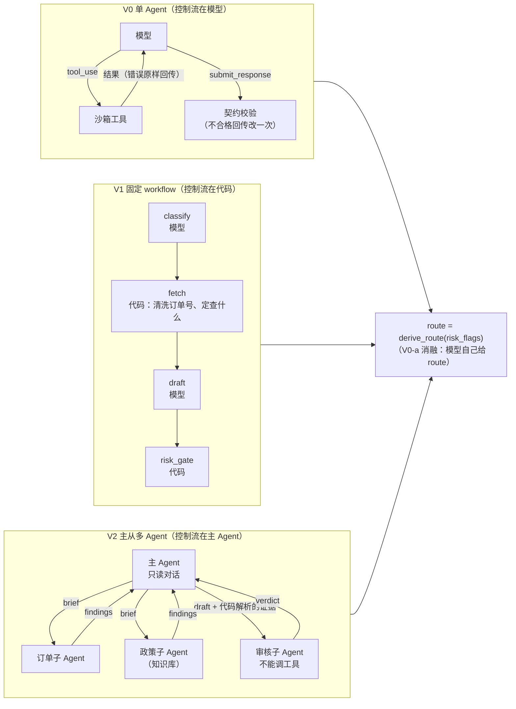

# 跨境女装询盘 / 售后 Agent：三种架构的对照实验

> **English summary.**
> An inquiry and after-sales agent for a fictional cross-border women's fashion store (Northwren), built three ways on one shared sandbox, knowledge base and output contract: V0 a hand-written single-agent loop, V1 a fixed LangGraph workflow, V2 an orchestrator with order, policy and review workers.
> Routing (auto-reply / draft for review / escalate) is derived in code from model-reported risk flags; an ablation (V0-a vs V0-b) measures what is lost when the model decides the route itself.
> Every factual statement in a reply carries a claim-level citation (KB line range or tool-result field), checked deterministically for ghost citations, contradictions and unsourced facts.
> Status: all three architectures, the label-free metrics and 142 tests are done and pass. V0-b has been run on all 180 messages with DeepSeek V4.1 Flash (baseline, a same-config repeat to measure run-to-run noise, and two iteration rounds): $0.0008 per message, 100% contract-valid. V0-a, V1 and V2 have not been run on a real model yet, and the human gold labels are still pending, so this README reports no accuracy numbers.
> Limitations: fictional brand, synthetic messages, single-annotator gold labels.

**当前状态（2026-10-27）**：
- **已完成**：三种架构、无标签指标、运行和演示工具都写完了，142 个测试通过。V0-b 用 DeepSeek V4.1 Flash 跑了 180 条全量，包括基线、一次同配置重跑（用来测波动）和两轮迭代，第 3 轮跑了 122/180 后因 API 余额不足暂停。
- **还没做**：V0-a、V1、V2 还没有用真实模型跑过；金标还没标。所以下面没有任何准确率数字。

## 1. 解决什么问题

跨境女装独立站的客服邮箱每天收到几类消息：包裹到哪了、尺码不合适想换、降价了想补差价、收到有瑕疵、批发询价，以及少量高风险的：威胁差评、提到信用卡拒付、冒充别人查订单、在邮件里夹带"忽略之前的指令"。

选这个场景的原因：

- **事实密集**：回复里几乎每句话都是一个可核对的事实（日期、金额、状态、政策条款），说错就是真金白银的损失。这让"有没有编造"可以被确定性地检查。
- **风险分层天然存在**：同样是"回复客户"，问物流可以自动发，要退款必须人审，提到律师必须转人工。这让"AI 的决策权限边界"有了具体的样子。
- **跨语言、跨时区、新旧政策并存**：英 / 德 / 西 / 法四种语言，订单时间戳是 UTC，运费政策 9 月改过一版。这些是真实客服里最常出错的地方。

品牌、订单、消息都是虚构的（`eval/`），180 条候选消息覆盖 13 类难例。

## 2. 三种架构

三者用同一个沙箱（`sandbox/`）、同一份知识库（`eval/kb/`）、同一份输出契约（`contract/output.schema.json`）、同一套评分（`scoring/`），**只有控制流不同**。



| | V0 | V1 | V2 |
|---|---|---|---|
| 代码 | `agents/v0.py`（146 行，无框架） | `agents/v1.py`（LangGraph） | `agents/v2.py`（复用 V0 的循环） |
| 谁决定查什么 | 模型 | 代码，按 classify 的结果 | 主 Agent 派单，子 Agent 决定 |
| 订单号 `#10231` | 沙箱报错，模型自己改 | fetch 节点由代码清洗 | 订单子 Agent 自己改 |
| 路由 | V0-b：代码推导；V0-a：模型给 | 代码推导 | 代码推导 |

关键设计都写成了 ADR（`docs/design_decisions.md`），V0 的逐段导读在 `docs/V0_walkthrough.md`。

## 3. 结果

> 下面只有无标签指标（`scoring/label_free.py` 生成）。路由、意图、风险的准确率**必须等金标**，在那之前一律不填，也不填估计值。
> 模型：`deepseek-flash`（DeepSeek V4.1 Flash），走 DeepSeek 的 Anthropic 兼容接口；代码也支持 `--provider anthropic` 切回 Claude。

| 指标（V0-b，180 条） | 基线 | 同配置重跑两次（波动范围） | 第 2 轮后 |
|---|---|---|---|
| 契约合规率 | 100% | 100% / 100% | 100% |
| 失败率（含被迫转人工） | 0.6% | 0.0% / 1.1% | 0.6% |
| 幽灵引用回复占比 | 1.1% | 2.4% / 0.0% | 1.7% |
| 无来源事实回复占比（日期 / 金额 / 订单号） | 9.8% | 6.5% / 7.6% | 4.0% |
| 同上，不算客户自己在对话里说过的 | 4.6% | 2.4% / 1.8% | 1.1% |
| 工具数据矛盾回复占比 | 0% | 0% / 0% | 0.6% |
| 路由与自报风险标签不一致 | 0（构造保证） | 0 / 0 | 0 |
| 成本 $/条 | $0.0008 | $0.0008 / $0.0008 | $0.0008 |
| 缓存命中率 | 95.4% | 95.1% / 96.1% | 94.3% |
| 延迟 p50 / p95 | 12.0s / 25.8s | 11.9s / 28.2s · 12.0s / 29.3s | 11.9s / 26.2s |

- "同配置重跑"列的两次运行用的是第 1 轮的 prompt，代码完全相同（prompt 指纹一致）。两次之间的差就是模型本身的随机波动。
- 金标指标（高风险捕获率、误拦率、路由准确率、意图 macro-F1）：**待金标**。
- V0-a、V1、V2：**还没有真实运行**。三者的对比结论目前只是假设，见第 4 节。
- 每一轮改了什么、为什么改、结果怎样，见 `docs/iteration_log.md`。

## 4. 发现

### 已有数据支撑的

1. **重跑波动比单轮改进还大，所以要先测噪声，再谈改进。** 同一配置跑两次：幽灵引用一次 4 条、一次 0 条；被迫转人工一次 0 条、一次 2 条；自动回复占比相差 5 个百分点。只看一次运行，第 1 轮"幽灵引用从 2 条变成 4 条"会被误读成退步。所以迭代日志只把"两次运行方向一致、并且超出波动"的变化算作改进。
2. **最典型的错误来自我们自己写的说明，不是模型。** 基线里有几条回复在向客户索要订单号时写了"例如 10231"，被指标判为无来源的订单号。读执行轨迹后发现，这个号码出自我们自己写的 `get_order` 工具描述，而它恰好是沙箱里另一位客户的真实订单号。修复是把示例号换成格式说明，属于工具描述层，成本最低的一层。修复后这类错误从每次 2–3 条降到 0。
3. **无标签指标本身也要迭代。** 第一版"无来源事实"把客户自己说过的日期和订单号也算作编造：输出契约里没有"来自对话"这种来源类型。读了轨迹才发现这一点，于是新增一列不算对话里已出现的内容，原列保留、统计口径不变。

### 还待验证的假设（V0-a / V1 / V2 跑完后才能回答）

1. **路由收回代码更安全**：V0-a 会出现"自报了退款标签却给 AUTO_REPLY"的自相矛盾。验证：V0-a 的"路由与自报风险标签不一致率"；有金标后比较 V0-a / V0-b 的高风险捕获率。
2. **这个任务不需要多 Agent**：KB 只有约 6–7K tokens，单 Agent 没有上下文压力，V2 的成本会是 V0 的 1.5–2.5 倍，无标签指标不会更好。验证：`label_free.py` 的成本列和 V2 专有的"上下文割裂"表。
3. **V1 用灵活性换可预测性**：订单号不规范、注入类消息上 V1 更稳；"查了才知道下一步查什么"的消息上 V1 会卡住。验证：非法参数调用数、trace 里草稿的"无法确认"类句子（`docs/design_decisions.md` 末尾的表）。

## 5. 怎么复现

```bash
uv venv --python 3.12 .venv && uv pip install --python .venv/bin/python pyyaml jsonschema pytest anthropic langgraph python-dotenv
cp .env.example .env                                # 填 DEEPSEEK_API_KEY（默认）或 ANTHROPIC_API_KEY，和可选的 ITER_BUDGET_USD
.venv/bin/python -m pytest -q                       # 142 passed, 5 skipped（5 个是留给读者的练习）
.venv/bin/python tools/check_data.py                # 数据自检，0 错误

# 不花钱：脚本模拟模型跑通整条管线（结果没有比较意义）
.venv/bin/python run.py --arch V0 --run-id smoke --fake
.venv/bin/python demo.py m003 --arch V2 --fake

# 真实运行（默认 DeepSeek，--provider anthropic 切到 Claude；预算上限读 ITER_BUDGET_USD，默认 $30，到 85% 自动停）
# V0-b 全量一次约 $0.14（deepseek-flash）
scripts/run_matrix.sh calibrate                     # 先跑 10 条，看每条成本
scripts/run_matrix.sh baseline                      # V0-b 全量，开始迭代
scripts/run_matrix.sh final v1                      # 迭代后的对照矩阵（按预算优先级）
.venv/bin/python scoring/label_free.py runs/V0-b/v1-r1 runs/V1/v1-r1 --out reports/label_free.md

# 有金标之后
.venv/bin/python scoring/score.py runs/V0-b/v1-r1 runs/V0-b/v1-r2 runs/V0-b/v1-r3 --split dev --out reports/v0b-dev.md
```

## 6. 上线边界

- **路由由代码决定**，模型只负责识别风险标签；策略表在 `eval/policy/risk_policy.yaml`，多个标签取最严的一档。
- **每个事实都带出处**：审核员看到的草稿里，每条 claim 都指向 KB 的行号或某次工具调用的字段，可以逐条核对。
- **agent 没做完就转人工**，并写明原因；崩溃写 `errors/`，不写残缺输出。
- **上线门槛**（都还没满足）：有金标后高风险捕获率 ≥ 90%、误拦率 ≤ 10%；LLM 判官和人工的一致率 ≥ 90% 后，才能用判官统计越权承诺。

## 7. 局限

- **虚构品牌、合成消息**：180 条消息由 AI 生成，作者自查列出了 20 条最不像真人的（`OVERNIGHT_REPORT.md` 3.3）。结论只适合比较架构，不代表真实客户上的绝对表现。
- **金标为单人标注**：只有一个标注者，没有标注者间一致率。
- **确定性检查有盲区**："无来源事实"只抽日期、金额、订单号；状态描述和越权承诺要等 LLM 判官，判官还没实现、也没校准。
- **价格表未核实**：`config/pricing.yaml` 里 deepseek-flash 的单价来自第三方资料，没有对照 DeepSeek 官方价格页，成本数字可能有偏差；实际扣费以 DeepSeek 控制台为准。
- **模型名是别名**：`deepseek-flash` 由 DeepSeek 指向具体版本（文档说目前是 V4.1-Flash-1017），版本更换会混进对比；目前所有运行都在同一天内完成。
- **迭代样本小**：每一类错误只有 1–3 条，改进只记作"方向一致"，可能过拟合，详见 `docs/iteration_log.md`。

这个项目是 `order-incident-agent` 的延续与升级：新增了评测体系、风险路由和架构对比。

## 目录

| 目录 | 内容 |
|---|---|
| `agents/` | `llm.py`（调用、计费、预算、重试、缓存）、`common.py`（契约、run 目录）、`prompts.py`、`v0.py`、`v1.py`、`v2.py`、`fake_scripts.py` |
| `run.py` / `demo.py` | 统一入口 / 终端里打印一次完整 trace |
| `scoring/` | `route.py` 路由推导、`score.py` 金标指标、`label_free.py` 无标签指标 |
| `sandbox/` | 4 个模拟接口 + 日志 + 可复现故障注入；知识库行号加载器 |
| `eval/` | 知识库、订单 / 商品 / 物流数据、策略表、180 条消息、标注规范（生成消息时的封存说明 `_sealed/` 不在公开仓库里，避免评测集答案泄露） |
| `tools/` | 数据自检、标注、一致率、分层切分 |
| `docs/` | 设计决策、V0 导读、迭代日志、面试准备 |
| `config/` | 模型与价格 |
| `scripts/run_matrix.sh` | 阶段 5 的运行矩阵，按预算优先级 |
