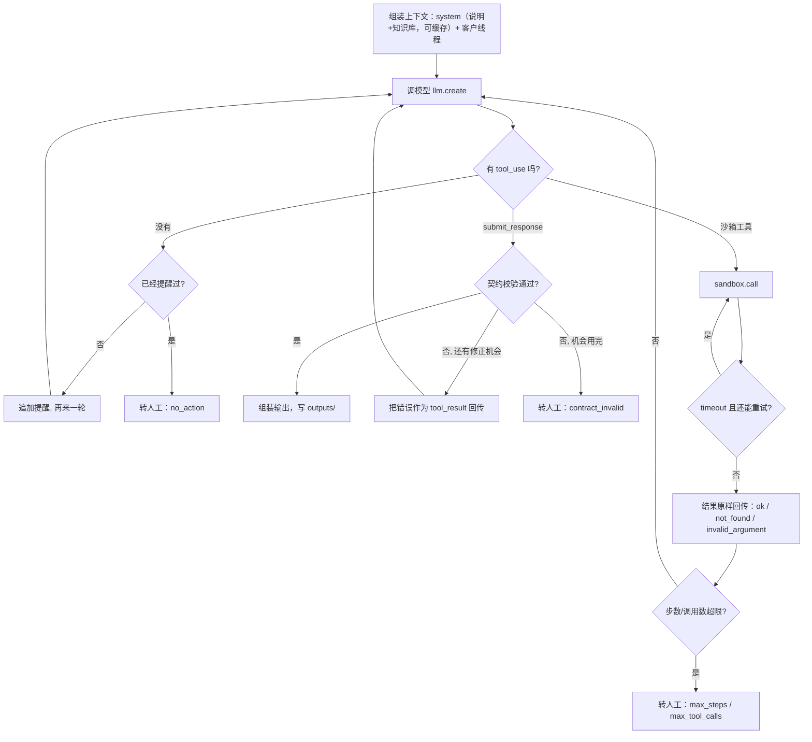

# V0 代码导读：手写 agent loop

> 对象：`agents/v0.py`（146 行）以及它用到的 `agents/common.py`、`agents/llm.py`、`agents/prompts.py`。
> 读法：开一个编辑器窗口，按本文的顺序从上往下读。每段先说**这段在做什么**，再说**为什么这样写**、**换一种写法会怎样**。
> 最后一节是 5 个留给你亲手做的小改动，每个都有现成的验收测试（`tests/test_v0_exercises.py`）。

## 0. 一句话

Agent 就是一个 `while` 循环：**把对话发给模型 → 模型要工具就执行工具、把结果追加进对话 → 再发给模型**，直到模型调用 `submit_response` 交卷，或者撞到某个上限、交给人工。V0 的全部复杂度都在"什么时候停、出错怎么办"，而不在"怎么调模型"。



## 1. `Limits`：先把所有上限写在一处（v0.py 第 21–28 行）

```python
max_steps = 10, max_tool_calls = 12, max_timeout_retries = 2, max_contract_fixes = 1, max_nudges = 1
```

**为什么这样写**：agent 的每个失败模式最后都表现为"不停"——反复调同一个工具、反复交不合格的卷、一直说话不行动。把所有上限集中成一个 dataclass，面试时可以一眼说清楚"这个 agent 最坏情况下花多少钱、走多少步"。最坏成本 ≈ `max_steps` 次模型调用。

**换一种写法**：很多框架只有一个 `max_iterations`。那样的话"工具调用太多"和"模型反复交错卷"会被混成一个失败原因，日志里就分不出该修 prompt 还是该修工具描述。V0 每种上限对应一个 `handoff_reason`，`scoring/label_free.py` 按它分类统计。

**数字怎么来的**：典型的 WISMO（物流查询）需要 `get_order` + `get_tracking` + 交卷 = 3 步；多意图线程大概 5–6 步。10 步留了约一倍余量。这是先验，等真实运行的步数分布出来再调（`label_free.py` 会报平均步数）。

## 2. `LoopResult`：循环只返回事实，不返回契约输出（第 31–37 行）

`agent_loop` 返回"交上来的内容 / 为什么转人工 / 走了几步 / trace"，**不返回契约输出**。契约输出由 `run_v0` 组装。

**为什么**：这样 `agent_loop` 不知道订单、知识库、契约是什么，V2 的主 Agent 和三个子 Agent 直接复用同一个函数（`agents/v2.py`）。面试时这是一个好例子：**循环是通用的，业务约束通过两个函数注入**——`run_tool`（怎么执行工具）和 `check_submit`（怎么判定交卷合格）。

## 3. 第一步：调模型（第 48–55 行）

```python
reply = llm.create(system=system, messages=messages, tools=tools, meter=meter, tag=tag)
messages.append({"role": "assistant", "content": reply.content})
```

**为什么把 `reply.content` 原样追加**：模型这一轮可能同时返回思考块、文字和若干个 `tool_use`。思考块必须原样传回去（Sonnet 5.5 默认开着自适应思考），只抽出文字再追加会丢状态。

**`llm.create` 里藏着的三件事**（`agents/llm.py`）：
- **缓存**：system 里"说明 + 整个知识库"（约 2.2 万字符）带 `cache_control`，并且请求顶层也开了自动缓存，所以第 2 步起，前面几轮对话也从缓存读。知识库对所有消息都一样，第二条消息起就是缓存命中。价格上，缓存读取是正常输入价的 1/10（Sonnet 5.5：$0.20 vs $2.00 / 百万 tokens）。**实测省了多少要等有 key 之后看 `label_free.py` 的 cache 命中率**，目前没有数字。
- **计费**：每次调用把四种 token（未缓存输入、缓存写、缓存读、输出）分别计价，记进本条消息的 `Meter` 和全局 `Budget`。
- **预算熔断**：`Budget` 把花费持久化到 `runs/_budget_ledger.jsonl`，跨多次 `run.py` 累计；到上限 85% 就抛 `BudgetExceeded`，`run.py` 停止派发新消息，已完成的不受影响，下次用同一个 `--run-id` 续跑。

**换一种写法**：用 SDK 自带的 `max_retries`。可以，但重试次数就不进我们的日志了。这里把 SDK 重试关掉（`max_retries=0`），自己做指数退避，次数有上限，测试覆盖了"429 后成功"、"重试用完"、"400 不重试"三种。

## 4. 第二步：模型既不调工具也不交卷（第 57–64 行）

提醒一次（`prompts.NUDGE`），还不行就转人工，原因记为 `no_action`。

**为什么只提醒一次**：模型直接用文字回答，通常是它把"回复客户"理解成"在聊天框里回答"。提醒一次足以纠正；连续两次说明它卡住了，再提醒只会烧钱。

**换一种写法**：Sonnet 5.5 不支持 `tool_choice: any`（强制调用工具会返回 400），所以没法在 API 层面"强制交卷"。这一点值得在面试里说：**模型能力变了，控制手段就要跟着变**。

## 5. 第三步：逐个处理 `tool_use`（第 66–101 行）

同一轮的所有工具结果放进**一条** user 消息回传。拆成多条消息，会让模型以后不再并行调用工具。

### 5.1 交卷：契约校验，给一次修正机会（第 69–79 行）

`check_submit` 做的事和评分脚本完全一样：把模型交上来的内容和**沙箱实际日志**拼成完整输出，跑 `contract/validate.py`。所以模型引用了一个没调用过的 `call_id`、引用了一个不存在的意图、ESCALATE 却没写 `handoff_note`，都会在这里被拦下，错误列表作为 `is_error` 的 tool_result 回传给模型改一次。改完还不合格就转人工（`contract_invalid`）。

**为什么 `tool_calls` 不让模型填**：`tool_calls` 必须和工具日志逐条一致。让模型抄一遍只会多一个出错点。凡是能从事实得出的字段（`msg_id`、`tool_calls`、`meta`，以及 V0-b 的 `route`）都由代码填，模型只填需要判断的部分。见 `agents/common.py::submit_tool`，工具 schema 由契约自动生成，删掉这些字段。

**换一种写法**：不给修正机会，校验失败直接写 `errors/`。那样失败率会更高，但每个失败都更"干净"。给一次机会是因为大部分契约错误是格式问题（比如 `lines` 写成了 `[5]`），一次反馈就能改对；两次还错，说明是理解问题，交给人。

### 5.2 不认识的工具名（第 81–83 行）

直接回错误，**不发给沙箱**。沙箱也会对未知工具返回 `invalid_argument`，但那样会在日志里留一条无意义的调用，污染"非法参数调用数"指标。

### 5.3 沙箱调用和 timeout 重试（第 85–99 行）

```python
while True:
    if res.tool_calls >= limits.max_tool_calls: return _handoff(res, "max_tool_calls")
    res.tool_calls += 1
    r = run_tool(u["name"], u["input"])
    if r["status"] != "timeout" or attempts >= limits.max_timeout_retries: break
    attempts += 1
```

- **timeout 由代码重试**：超时是基础设施问题，和模型的判断无关，让模型自己决定重不重试只会浪费一次模型调用。每次重试都是一次新的沙箱调用、新的 `call_id`，日志里看得见，评分时记为"重复调用"而不是"多余调用"。
- **重试次数计入 `max_tool_calls`**：否则故障注入率高时，一条消息可能在重试里打转。
- **`invalid_argument` / `not_found` 原样回传**：这是任务书的硬要求。客户写了 `#10231`，模型第一次可能原样传进去，沙箱返回 `order_id must be digits only`，模型读到错误后自己去掉 `#`。**代码不替模型规范化订单号**：规范化是"理解客户写了什么"，属于模型的工作；在 V0 里由代码兜底，就测不出模型这方面的能力。对比 V1：V1 是 workflow，fetch 节点本来就由代码控制，在那里规范化订单号是合理的架构差异（见 `docs/design_decisions.md` ADR-2）。

## 6. 转人工（第 103、113–116 行）

所有"停不下来"的出口都走 `_handoff(reason)`，`run_v0` 再用 `handoff_output` 生成一条**合法的** ESCALATE 输出，`meta.fallback = true`，`meta.handoff_reason` 写明原因。

**为什么不写 `errors/`**：生产里 agent 没做完，这条消息就留在人工队列，这正是 ESCALATE 的含义。写成合法输出，评分时能区分"agent 判断要转人工"（`fallback` 不存在）和"agent 没做完被迫转人工"（`fallback = true`）。只有 runner 崩溃、或者最终输出仍不合契约时才写 `errors/`（`run.py::process`）。

**代价**：fallback 输出的 `intents` 是占位的 `["OTHER"]`（契约要求至少 1 个）。有金标后算意图准确率时，这些消息会被算错。我选择让它算错，而不是从分母里排除：失败本来就应该受罚。

## 7. `run_v0`：把通用循环接到沙箱和契约上（第 123–146 行）

- `variant="a"`：`submit_response` 里有 `route` 字段，模型自己决定路由。
- `variant="b"`（默认）：schema 里**没有** `route`，模型只报 `risk_flags`，代码用 `scoring/route.py::derive_route`（和评分脚本同一个函数）推导路由。

这就是路由消融实验。**思想：不该交给模型的决策，收回到代码里。** 路由是一条确定性规则（多个风险标签取最严格的一档），规则本身没有模糊性，模糊的只是"消息里有没有某个风险"。把规则交给模型，等于让它同时做两件事：识别风险、再背一遍规则。第二件事代码做得更好，而且可审计。变体 a 的意义在于量化这个收益：有金标后比较两者的高风险捕获率和误拦率。没有金标时，可以先看一个不需要金标的指标：**变体 a 里，模型给出的 route 和用它自己报的 risk_flags 推导出的 route 不一致的比例**（`label_free.py` 里的"路由自相矛盾率"）。这个数越高，说明把路由交给模型越不可靠。

`meta()` 每次调用都重新生成，因为 `check` 在循环中途调用时也需要一个合法的 meta 才能过契约校验。

## 8. 读完你应该能回答

1. 一条消息最多会调用几次模型、几次沙箱？（10、12，外加 timeout 重试计入 12）
2. 模型引用了一个返回 `not_found` 的调用当证据，会发生什么？（交卷能通过：契约校验只查 call_id 是否在 tool_calls 里，不查那次调用是否成功。它会在评分时被记为幽灵引用。**这是一个可以补上的缺口**，见第 9 节末尾的思考题。）
3. 为什么 V0-b 的模型看不到 route 字段，而不是"看得到但被代码覆盖"？（看得到就会花 token 去判断，并且 trace 里会出现"模型想 AUTO、代码改成 ESCALATE"的混乱记录。）

## 9. 留给你亲手完成的 5 个小改动

做法：在 `tests/test_v0_exercises.py` 里删掉对应测试的 `@TODO`，改代码直到它通过，并且 `pytest -q` 全绿。每个改动都应控制在 15 行以内。

| # | 改动 | 验收标准 | 测试 |
|---|---|---|---|
| 1 | **timeout 重试加退避**：`Limits` 加 `retry_backoff_s`，`agent_loop` 加可注入的 `sleep` 参数（默认 `time.sleep`），第 k 次重试前等 `retry_backoff_s * 2**k` 秒 | 两次重试分别等 0.5s 和 1.0s；默认值下现有测试不变慢 | `test_ex1_timeout_retry_backs_off` |
| 2 | **按 token 预算截断**：`Limits` 加 `max_input_tokens`，每次模型调用后检查 `meter.tokens_in`，超了就转人工，原因 `token_budget` | 每轮 3 万 tokens、上限 10 万时，第 4 轮后停下，`tokens_in` ≤ 13 万 | `test_ex2_stop_on_token_budget` |
| 3 | **not_found 时提示换邮箱查**：`get_order` 返回 `not_found` 时，在回传给模型的内容里附一句"可以用 find_orders_by_email 按发件邮箱查"。注意：只加提示，**不**替模型改订单号 | tool_result 里出现 `find_orders_by_email`，`status` 仍是 `not_found` | `test_ex3_not_found_order_suggests_email_lookup` |
| 4 | **相同调用去重**：同一个工具、同样参数、之前返回过 `ok`，就直接回传之前的结果（同一个 `call_id`），不再调沙箱 | 模型连续两次 `get_order 10231`，沙箱日志只有 1 条 | `test_ex4_identical_call_is_served_from_memory` |
| 5 | **转人工时说清楚做过什么**：`handoff_note` 里列出调用过的工具和各自的状态 | 超步数转人工时，`handoff_note` 含 `get_order` 和 `ok` | `test_ex5_handoff_note_says_what_was_tried` |

做完每一个，想一想它会让哪个无标签指标变化（提示：1 → 延迟；2 → 成本 p95；3 → 非法参数调用数之后的恢复率；4 → 重复调用数；5 → 不影响指标，影响的是人工处理效率，这正是"指标覆盖不到的上线价值"）。

**思考题（不配测试）**：第 8 节第 2 问提到的缺口——要不要在 `check_submit` 里加"引用了非 ok 调用"的检查？加了，幽灵引用率会下降，但这是因为模型被提前纠正了，还是因为指标被"教"了？这个问题没有标准答案，它就是面试官会问的"你怎么防止自己骗自己"。
